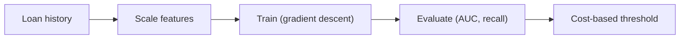

# Loan Default Prediction

> Logistic regression from scratch, with the metrics a credit committee actually asks about.

   

**Sector:** Fintech & Machine Learning  ·  **Project 37 of 50** in my [AI Automation Projects series](https://github.com/Princewill106/Princewill106)

## The problem

Lenders need to know who is likely to default, but also why, so they can explain decisions to customers and regulators. Black-box models are hard to defend; a well-built logistic regression is still the industry workhorse for credit scoring.

## How it works



1. **Data** — Historic loans with income, loan amount, tenor, existing debts, previous defaults, account age and the outcome (`sample_loans.csv`, synthetic).
2. **Prepare** — Features are standardised and the data split 75/25, stratified by outcome.
3. **Train** — Logistic regression is fitted by batch gradient descent with L2 regularisation.
4. **Evaluate** — Accuracy, precision, recall, ROC-AUC and the confusion matrix are reported on the test set.
5. **Decide** — The decision threshold is chosen to minimise expected cost, where a missed default costs 5× a wrongly declined good customer.

## Features

- Logistic regression with gradient descent (no scikit-learn)
- Standardisation and stratified split
- ROC-AUC computed from scratch
- Business-cost threshold selection
- Readable coefficients (odds ratios)

## Quick start

```bash
git clone https://github.com/Princewill106/loan-default-prediction.git
cd loan-default-prediction
python make_sample.py && python main.py --demo
```

No installs needed: it uses only the Python standard library. The demo runs fully offline using the sample data in this repo.

**Optional: plug in an LLM.** Copy `.env.example` to `.env` and add an Anthropic or OpenAI key. The project will then use the model for the language-heavy steps and fall back to its rule-based logic if a call fails.

Run the tests:

```bash
python -m unittest -v
```

## Sample output

```text

```

## Use it on your own data

Replace `sample_loans.csv` with your own history (same columns, `defaulted` as 0/1) and run `python main.py`. Change `COST_FN`/`COST_FP` to match your economics. The sample data is generated by `make_sample.py` (run it once before the demo).

## Project structure

```text
.env.example                 Optional API key settings
.gitignore                   Git ignore rules
LICENSE                      MIT license
README.md                    This file
llm.py                       Optional LLM helper (offline fallback)
main.py                      Entry point and core logic
make_sample.py               Supporting file
requirements.txt             Dependencies (stdlib only)
sample_loans.csv             Sample input data for the demo
test_main.py                 Unit tests
```

## Who this is for

- Credit risk analysts
- Data science students
- Pairs with Loan Application Triage in this series

## Ideas to extend it

- [ ] Weight of evidence / scorecard points
- [ ] Compare with gradient boosting
- [ ] Model monitoring for drift
- [ ] FastAPI scoring endpoint

## About

Built by **Ogbu Ugochukwu Princewill**, AI Automation Lead and robotics engineer. I teach people and businesses to build with AI, not just talk about it. [LinkedIn](https://www.linkedin.com/in/ugochukwu-ogbu-653a0816a)

If this helped you, give it a ⭐ and share what you built with it.

## License

MIT — see [LICENSE](LICENSE).
